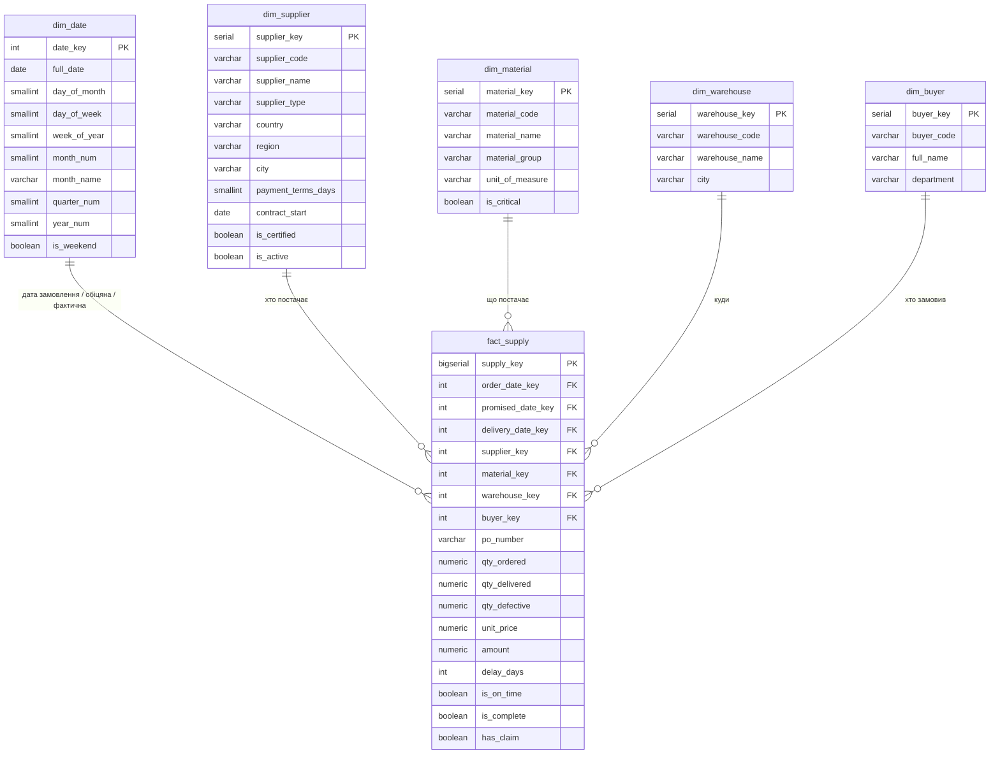

# Діаграма сховища даних (Dimensional Model)

Схема «зірка». У центрі — таблиця фактів `fact_supply`, навколо — п'ять вимірів. Вимір `dim_date` підключено тричі: дата замовлення, обіцяна дата й фактична дата поставки.

GitHub показує цю діаграму автоматично. Для звіту у Word зробіть знімок екрана або перемалюйте її в draw.io / pgModeler.
